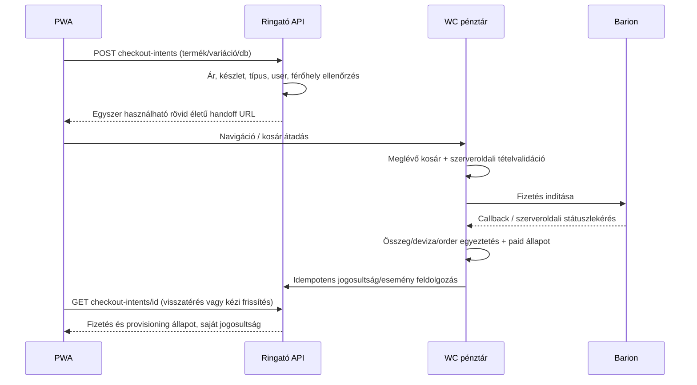

# 02 – Architektúra

## 1. Célarchitektúra és telepítés

**Ajánlott: ugyanazon origin, külön `/app/` felület, moduláris WordPress backend.** Nincs második felhasználó- vagy rendelésrendszer, nincs szinkronizált külön webshop. React statikus assetek + vékony WP app shell, saját WP REST API, ugyanaz a WC pénztár.

A szolgáltató tényleges domainje telepítési beállítás. A példabeli éles URL `https://ringatoviraggal.hu/app/`; a www/non-www kanonikus origin következetesen ugyanaz, mint a WordPress site URL. A helyi `localhost:8080` nem éles push- vagy fizetéskompatibilitási bizonyíték.

**D12 megerősített környezet (2026-10-15, projektgazdai információ):** a tárhelyen már van **tesztdomainen működő WP tesztpéldány**, továbbá a fejlesztő elkészítette a **lokális fejlesztői környezetet**. A staging a PWA/pluginek telepítésének, frissítésének és visszaállításának ellenőrzési helye; a tesztdomain külön origint jelent az éles webhelyhez képest. A tárhely **PWA assetek és shell kiszolgálására alkalmas**, de ebből nem következik a médiastreaming elegendő párhuzamos kapacitása. A várható egyidejű médiahasználatra terhelési próba és szükség esetén külön streaming/CDN opció költségvizsgálata kell (D10).

### Komponensek

| Komponens | Felelősség | Nem tartozik hozzá |
|---|---|---|
| React PWA | UX, kliensoldali lejátszás, API-kérések, kamera, push feliratkozás | Fizetési/jegy/férőhely döntés |
| App Shell plugin | `/app/` útvonalak, build assetmanifest, bootstrap, manifest/SW kiszolgálás | Téma módosítása, kereskedelmi logika |
| Core plugin | Domain service-ek, REST, saját adatmodell, jogosultság, admin, migráció, jobs | Kártyaadat-kezelés, második WC rendelésrendszer |
| WC adapter | Termék, rendelés, fizetett állapot és refund olvasás, HPOS CRUD | WC-táblák közvetlen írása |
| Event adapter | Meglévő CPT/meta → normalizált esemény; saját PWA-kiegészítés | Meglévő naptár újraírása |
| Prémium-hozzáférési adapter (MVP) | Kifizetett havi időszak, lejárat, újravásárlás; fizetési módtól független | Automatikus kártyaterhelés |
| Későbbi kész recurring adapter (feltételes) | Jóváhagyott, külső kész integráció előfizetési státuszának leképezése a közös hozzáférésre | Saját recurring gateway/bridge fejlesztés a jelenlegi projektben |
| Better Messages adapter | Szülő–Virág beszélgetés, DTO, transport | Új üzenettároló BM mellett |
| Poll adapter / PollService (D13 / P01, V1 kötelező) | WordPress admin kérdés- és opciókezelés; bejelentkezett PWA-szavazat, egyediség, összesített eredmény | Kliensoldali szavazatszámlálás vagy hozzáférés más felhasználó válaszához |
| Média adapter | Forrásazonosító → lejáró CDN hozzáférés | Publikus prémium MP4 feltöltés |

Ajánlott Core belső rétegek: `Domain` (állapot és invariáns), `Application` (use case), `Infrastructure` (WP/WC/CDN/BM repository), `Http` (REST schema + permission), `Admin`, `Jobs`, `Migrations`. Egy moduláris plugin, nem mikroszolgáltatások. A prémium-jogosultságot elválasztjuk a fizetési modelltől, hogy az MVP egyszeri WooCommerce-vásárlásairól később kész előfizetési integrációra lehessen váltani, **saját recurring bridge fejlesztése nélkül**.

**D13 / P01 – V1:** a „Virág kérdezi” szavazás a Ringató Core elkülönített modulja. Virág WordPress adminjából kezelheti a kérdéseket, az opciókat és a közzétételt; a felhasználói választ és eredményt a PWA a saját API-ból éri el. Ajánlott alap: egy bejelentkezett fiók egy szavazat/poll; szerveroldali tranzakció és egyedi index, nem React/localStorage üzleti állapot. A válaszmódosítás és eredményláthatóság részletszabályait még egyeztetni kell. A felhasználói szavazat önmagában nem indít pushküldést.

## 2. Az eredeti oldal megőrzése

- Nincs téma-/template-/CSS-/JS-csere. A build csak `/app/` kéréseken töltődik; a shell nem hív `get_header()`/`get_footer()`-t, és nem futtatja a téma általános frontend enqueue-ját.
- A meglévő CPT-ket nem regisztráljuk újra, és az `event` összes metaadatát nem tesszük publikus REST-adattá. Engedélyezett mezőlista alapján olvasó adapter készül.
- Új eseménymezők külön névtérben, adminmetaboxként; az eredeti `_event_*` mezők olvasási források maradnak. A saját mezők mentése nonce/capability/autosave/revision ellenőrzéssel történik.
- REST `/wp-json/ringato/v1/`, adatbázis `{prefix}ringato_*`, CSS appban CSS Modules, PHP `Ringato\...`, job/capability `ringato_*` névtér.
- SW fájl `/app/sw.js`, regisztráció és scope `/app/`; nincs `Service-Worker-Allowed: /` szélesítés, nincs root SW. Meglévő idegen cache-t vagy SW-t a kód nem töröl.
- SPA fallback csak `/app/` navigációra; `/wp-json/`, `/wp-admin/`, pénztár és minden régi útvonal érintetlen. `/app/assets/...` hiányzó fájl 404, nem HTML-fallback.
- Pluginaktiváláskor nem változik meglévő termék státusza, ár, készlet, checkout, e-mail vagy oldal. **D01 elfogadott döntés:** a WooCommerce webes és PWA-termékkínálata egységes; az új előfizetés- és eseménytermékek a weben is megjelennek és megvásárolhatók. Nem rejtjük el alapból az app-előfizetést. Opcionális „csak webshopban” kivétel csak egyszerű, alap WooCommerce kategória/címke alapú jelölés technikai igazolása után lehet.
- Az apptermékekre/eseményekre vonatkozó kapacitás- és fizetési hookok termékazonosító alapján szűrtek. A meglévő termékek működése csak a tudatosan felvett digitális jogosultság-naplóval egészül ki.
- Változatlan pénztár = ugyanaz a kereskedelmi szabály és felület. Az app és web ugyanazt a WC kosarat használja; az app nem üríti ki vagy cseréli le csendben a meglévő kosarat.

Backend- és adatbővítések hatása regressziós teszttel igazolandó. Éles plugintelepítés, cron és WAF módosítás későbbi kiadási feladat, most nem történt.

## 3. Hitelesítés és jogosultság

### Döntés: WordPress session cookie + REST nonce

A böngésző a WordPress bejelentkezést használja. A login/elfelejtett jelszó a meglévő WP/WC folyamat biztonságos visszatérési URL-lel; új React jelszó-kezelő backend nem kell. **D12 megerősítés:** a jelenlegi webshop vásárlói jellemzően **vendégként, fiók létrehozása nélkül** vásárolnak; ezt a meglévő vásárlási lehetőséget nem tiltjuk le globálisan. A fiókalapú PWA-funkciókhoz és a D01/D09 szerinti havi prémiumtermék webes vásárlásához bejelentkezés kötelező, **termékszinten szerveroldalon érvényesítve**. A WooCommerce regisztráció / My Account / checkout account-creation beállításait és az új ügyfelek számára érthető belépési/regisztrációs átmenetet stagingben ellenőrizni kell; ha hiányzik, egyszerű támogatott módon ki kell alakítani. A korábbi vendégrendelés nem rendelhető automatikusan új fiókhoz pusztán e-mail-egyezés alapján (D08). Vendég publikus médiakatalógust/programot láthat, saját jegyet/foglalást/prémiumot nem. A meglévő webes fiókfelület esetleges nagyobb átalakítása külön scope (D01).

1. `/app/` shell a WP betöltése után felismeri a session cookie-t, és minimális bootstrapot ad: API base, build/API verzió, WP REST nonce, user summary, engedélyezett feature-ek. Nem tesz bele rendelést, QR-t vagy fizetési tokent.
2. A privát REST kérések `credentials: same-origin` és `X-WP-Nonce` mellett mennek. A nonce **CSRF-védelem, nem önálló hitelesítés**. Szerveren minden végpont saját permission callbacket és objektumtulajdonosi ellenőrzést kap. [WP dokumentáció](https://developer.wordpress.org/rest-api/using-the-rest-api/authentication/)
3. A lejárt nonce egyszer újra kérhető `/app/bootstrap.json` WP shell-végponton. Ez **nem REST végpont**, hogy az érvényes WP session nonce nélkül is új bootstrapot adhasson. Cookie-validáció, azonos originű kérés, CORS tiltás, `Cache-Control: private, no-store`, JSON MIME és `nosniff` szükséges; nem adhat idegen originnek tokent.
4. Nincs session vagy nonce localStorage-ban, Service Worker cache-ben vagy URL-ben. Nonce memóriaállapot. 401 esetén login, `rest_cookie_invalid_nonce` esetén egy bootstrap-frissítés; mutációt csak biztonságos idempotencia mellett próbálunk újra.
5. Kijelentkezés a WP logout nonce-os folyamatával, appbeli in-memory állapot/privát átmeneti tárolás törlésével. Több tabnak BroadcastChannel kijelentkezési jelzés; szerveroldali session érvénytelenítése is szükséges.

A WordPress cookie konfigurációját (path, HTTPS, SameSite, domain), a PWA és a checkout közötti sessionfolytonosságot tényleges iOS/Android eszközön igazolni kell. Ha aldomain kell, új ADR szükséges auth/CORS/cookie/BM/checkout megoldással; az aldomain nem egyszerű buildbeállítás.

### Capability-k

- Ügyfél: saját fiók, rendelés, jegy, foglalás, kedvencek, sor, értesítés, beszélgetés.
- `ringato_checkin`: kizárólag hozzárendelt programok staff ellenőrzés/beváltás, minimális családadat.
- `ringato_manage_events`, `ringato_manage_media`, `ringato_manage_push`, `ringato_manage_groups`, `ringato_view_audit`, `ringato_adjust_entitlements`: WP adminműveletek, külön kioszthatók.
- WooCommerce admin megmarad a saját role/capability szabályaival. A staff nem lesz automatikusan `administrator` vagy `shop_manager`.
- Tulajdonosi azonosító minden ügyfélmutációnál a sessionből származik; a kliens által beküldött `user_id` nem jogosultsági forrás.

## 4. Vásárlási folyamat

**V1 alapmegoldás: API-katalógus + checkout handoff a meglévő webes WC folyamatba.** Ez megfelel annak, hogy az appot WordPress API szolgálja ki; a fizetési felület a meglévő webshop.

A handoff URL tokenja magas entrópiájú, adatbázisban hash-elt, felhasználóhoz kötött, egyszer használható és ajánlottan 5 perces. Nem kap benne jelszót vagy WC consumer secretet a kliens. A mutáció az auth/CSRF-védett intent után, szűk pluginútvonalon történik; GET általános termékparaméterből nem készül jogosultság. A return target szerveroldali `/app/` allowlist, nincs open redirect.

Az app egyszerre egy kiválasztott termékfolyamatot indít; a webes kosár több terméket is tartalmazhat. A checkout-intent státusz a kapcsolt rendelésből származik. Az app nem tekinti sikernek a visszairányítást, URL-paramétert vagy kliensoldali WC status szöveget. A felhasználó a meglévő WC order-received felületről appba visszatérő linket csak app-origin rendeléshez kap; önálló visszatéréskor az app saját státuszt kérdez.

Egyedi típus (pl. ajándékutalvány): a katalógus `purchase_mode=web_configurator` és termék-URL. Az eredeti konfigurátor állítja össze a kosártételt; nem próbáljuk simple termékként hozzáadni. Változó terméknél érvényes variation és attribute adatok kellenek; szállítandó termékek teljes checkoutja a webshopban marad. Nem támogatott új típust listázunk webes útvonallal, nem veszítjük el csendben.

Publikus Store API hasznos, de az egyedi terméktípusok és az opcionális, natív WC-jelölésre épülő „csak webshopban” kivétel miatt a kliens egységes `/products` adaptert kap. A WC REST admin API kulcsai nem kerülnek frontendbe. A natív Store API checkout alternatíva külön kompatibilitási próbát igényel. [Store API](https://developer.woocommerce.com/docs/category/store-api), [cart token](https://developer.woocommerce.com/docs/apis/store-api/cart-tokens)

### Fizetett külön esemény: kapacitás és késő fizetés

A végleges hely fizetéstől keletkezik, de **átmeneti hold** szükséges a fizetés idejére a túlfoglalás kizárásához. Ajánlott hold 15 perc, szerver beállítás. Az event-product mapping minden vásárlási belépési pontjára érvényes: app intent, web kosár, checkout, order-pay. Nem elég csak az app REST kérésében ellenőrizni.

Lejárt hold után beérkező sikeres fizetés: ugyanazon eseményzár mellett új hely megszerzése; ha nincs hely, `paid_capacity_conflict`, staff ügyintézés és visszatérítés. Ilyenkor nem keletkezik érvényes jegy és nem jelenhet meg „foglalás megerősítve”. A pénzügyi státusz fizetett marad, a teljesítési állapot külön hibás. A normál webhook és a helyreállító job közös idempotens szolgáltatást használ.

## 5. Havi prémium-hozzáférés – D09 elfogadott MVP

**MVP:** új, havonta **manuálisan ismételten megvásárolható** WooCommerce-termék és a meglévő egyszeri Barion-fizetés. Az ügyfél weben vagy PWA-ból ugyanazon WC pénztáron keresztül, **bejelentkezett fiókkal** vásárol. Nincs automatikus terhelés, WooCommerce Subscriptions-licenc és recurring gateway nem szükséges az MVP-hez. Egyes vásárlások hiteles sikeres fizetése idempotens szerveroldali hozzáférési időszakot eredményez; az időszak számítását, az előre vásárlás és átfedés szabályait az implementálás előtt pontosítani kell. A meglévő régi Online Ringató-termékek ettől külön termékszabályok.

**Változatlan hozzáféréselv:** a médiához való hozzáférés a hitelesen **kifizetett időszak végéig** él. Nem elegendő pusztán egy WC order „completed” felirata vagy kliensállapot; refund/chargeback külön revocation üzleti szabályt igényel. A lejáró hozzáférést a rendszer jelzi, a hosszabbítást a felhasználó új vásárlással végzi. **A manuális időszakot nem lehet lemondandó automatikus előfizetésnek mutatni.**

**Későbbi, feltételes fázis:** ár/érték és teljes licenc/tranzakciós/üzemeltetési költség szerint kiválasztott, kész és működésében igazolt WooCommerce-kompatibilis recurring megoldás, kizárólag kifejezett megrendelői költségvállalás után. A meglévő Barion gateway recurring funkciója **nem igazolt**; a Barion API maga sem havi ütemező. [Barion subscriptions](https://docs.barion.com/Subscriptions%3A_set_up_recurring_billing). Saját fizetési bridge **nem része a jelenlegi projektkeretnek**. Az adaptercsere nem módosítja a Core paid-through jogosultsági szerződését, a meglévő hozzáféréseket migrálni/összefésülni kell. Később a megújulás/lemondás/kártyacsere/retry külön elfogadási teszt.

## 6. Média, push és üzenet

- Média metadata WP adminban; nyers prémium source ID csak backendben. Playback végpont minden indításkor jogosultságot ellenőriz és rövid életű hozzáférést kér a választott szolgáltatótól. A HLS manifest, segment és kulcs védelem együtt szükséges; csak a manifest URL aláírása nem elég.
- Push manuális kampányból. Kampányküldéskor címzettpillanatkép, egy receipt/fiók, több eszközre szállítás. A push hálózati kézbesítés nem garantálható, a szerveroldali előzmény az igazságforrás. Nincs érzékeny üzenettartalom a zárképernyőn.
- Better Messages tárolja a thread/message adatot; saját adapter megakadályozza az idegen threadhez hozzáférést és az ügyfelek közötti üzenetküldést. A BM publikus/guest/call/file lehetőségei nem lesznek automatikusan appfunkciók.

## 7. Üzemeltetési határok

Statikus app assetek hosszú immutable cache; személyre szabott shell/bootstrap/API/checkout `private,no-store`. Privát API CDN/cache bypass, WAF útvonal- és capabilitytesztek. A WP és Core tranzakciók rövidek, nem tartanak adatbáziszárat külső HTTP-hívás alatt.

Action Scheduler a háttérmunkákhoz; éles rendszer-cron, amely WP due jobs futtatását biztosítja. Lejárt holdot a következő foglalás tranzakciója is felszabadítja, hogy cronhiba ne állítsa le a kapacitást. Jogosultságot API-híváskor időpont szerint is számolunk, nem várunk lejárati cronra.

Admin napló: beváltás, kézi korrekció, kampány, mappingváltozás, provisioning hiba. Operációs napló: request/correlation ID, hibaazonosító és idő; nincs jelszó, kártya, QR-token, chat szöveg vagy teljes push endpoint. Napi egyeztetés: fizetett rendeléstétel ↔ jogosultság, subscription paid-through, hold ↔ order, kampány ↔ receipt/job.
