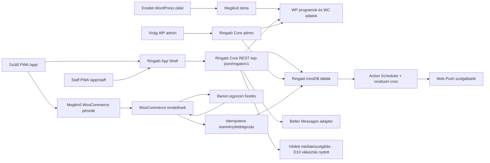
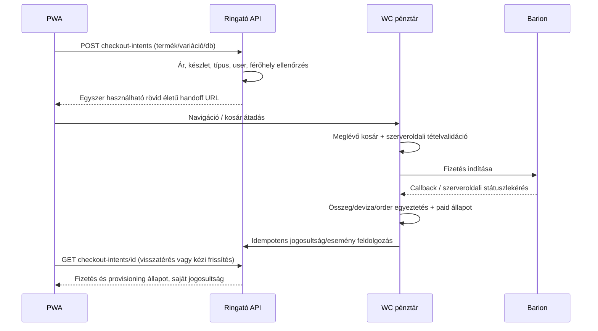

# 02 – Architektúra

**Munkarend (2026-10-15):** a fejlesztés és tesztelés lokálisan történik; tesztszerverre és élesre manuálisan telepítünk, majd rövid működésellenőrzést végzünk. A korábbi staging-tesztre utalásokat e rend szerint kell értelmezni; a tárhelyfüggő kapacitás/cron/WAF külön igazolandó. Minden növekményhez a [11. telepítési útmutató](11-lokalis-fejlesztes-es-manualis-telepites.md) szerint készül csomag és konkrét konfigurációs/másolási leírás.

## 1. Célarchitektúra és telepítés

**Ajánlott: ugyanazon origin, külön `/app/` felület, moduláris WordPress backend.** Nincs második felhasználó- vagy rendelésrendszer, nincs szinkronizált külön webshop. React statikus assetek + vékony WP app shell, saját WP REST API, ugyanaz a WC pénztár.

A szolgáltató tényleges domainje telepítési beállítás. A példabeli éles URL `https://ringatoviraggal.hu/app/`; a www/non-www kanonikus origin következetesen ugyanaz, mint a WordPress site URL. A helyi `localhost:8080` nem éles push- vagy fizetéskompatibilitási bizonyíték.

**D12 megerősített környezet (2026-10-15, projektgazdai információ):** a tárhelyen már van **tesztdomainen működő WP tesztpéldány**, továbbá a fejlesztő elkészítette a **lokális fejlesztői környezetet**. A staging a PWA/pluginek telepítésének, frissítésének és visszaállításának ellenőrzési helye; a tesztdomain külön origint jelent az éles webhelyhez képest. A tárhely **PWA assetek és shell kiszolgálására alkalmas**, de ebből nem következik a médiastreaming elegendő párhuzamos kapacitása. A várható egyidejű médiahasználatra terhelési próba és szükség esetén külön streaming/CDN opció költségvizsgálata kell (D10).

### Komponensek

| Komponens | Felelősség | Nem tartozik hozzá |
|---|---|---|
| React PWA | UX, kliensoldali lejátszás, API-kérések, kamera, push feliratkozás | Fizetési/jegy/férőhely döntés |
| App Shell plugin | `/app/` útvonalak, build assetmanifest, bootstrap, manifest/SW kiszolgálás | Téma módosítása, kereskedelmi logika |
| Core plugin | Domain service-ek, REST, saját adatmodell, jogosultság, admin, migráció, jobs | Kártyaadat-kezelés, második WC rendelésrendszer |
| WC adapter | Termék, rendelés, fizetett állapot és **D07 szerinti, rendeléstételre lekövethető igazolt refund** olvasás; HPOS CRUD | WC-táblák közvetlen írása és saját Barion refund gateway |
| Event adapter | Meglévő CPT/meta → normalizált esemény; saját PWA-kiegészítés | Meglévő naptár újraírása |
| Prémium-hozzáférési adapter (MVP) | Kifizetett havi időszak, lejárat, újravásárlás; fizetési módtól független | Automatikus kártyaterhelés |
| Későbbi kész recurring adapter (feltételes) | Jóváhagyott, külső kész integráció előfizetési státuszának leképezése a közös hozzáférésre | Saját recurring gateway/bridge fejlesztés a jelenlegi projektben |
| Better Messages adapter (D11) | Ingyenes BM REST/AJAX kétirányú szöveges V1 chat, saját thread/read-state és aktív képernyőn kb. 10 s polling | Új üzenettároló BM mellett és kötelező fizetős WebSocket |
| Poll adapter / PollService (D13 / P01, V1 kötelező) | WordPress admin kérdés- és opciókezelés; bejelentkezett PWA-szavazat, egyediség, összesített eredmény | Kliensoldali szavazatszámlálás vagy hozzáférés más felhasználó válaszához |
| Média adapter | Forrásazonosító → jogosultságellenőrzött, lejáró helyi vagy külső stream-hozzáférés (D10 alapján választható) | Nyilvános prémium URL vagy előre rögzített CDN-szolgáltató |

**D12 – adatkezelési scope (2026-10-16):** külön jogi tanácsadást, új általános anonymizáló-/törlőmotort és önálló GDPR export/erase API-t nem építünk. Használjuk a WordPress/WooCommerce/Better Messages/Billingo meglévő támogatott folyamatait; a hozzáférésvédelem, adatminimalizálás, logout/session-takarítás, push eszközleválasztás és üzleti jogosultságkorrekció funkcionális része változatlan. Saját megjelenítési/adatéletciklus-időablakok lehetőség szerint WordPress-konfigurációval állíthatók (D06 inbox 365 nap alapértelmezett láthatóság), de nem tekinthetők automatikus jogszabályi megőrzési időnek. Konkrét kötelező jogi időt csak a megrendelő adatkezelői ellenőrzése után írunk be. Ha a meglévő rendszer nem biztosít egy szükséges adatvédelmi műveletet, hiányt jelentünk és külön scope/üzemeltetési megoldás kell; nem állítunk implicit teljes GDPR-megfelelést.

Ajánlott Core belső rétegek: `Domain` (állapot és invariáns), `Application` (use case), `Infrastructure` (WP/WC/CDN/BM repository), `Http` (REST schema + permission), `Admin`, `Jobs`, `Migrations`. Egy moduláris plugin, nem mikroszolgáltatások. A prémium-jogosultságot elválasztjuk a fizetési modelltől, hogy az MVP egyszeri WooCommerce-vásárlásairól később kész előfizetési integrációra lehessen váltani, **saját recurring bridge fejlesztése nélkül**.

**D13 / P01 – V1:** a „Virág kérdezi” szavazás a Ringató Core elkülönített modulja. Virág WordPress adminjából kezelheti a kérdéseket, az opciókat és a közzétételt; a felhasználói választ és eredményt a PWA a saját API-ból éri el. **D13/01 elfogadva (2026-10-16):** egy bejelentkezett fiók szavazásonként egy **végleges** választ adhat le; PWA-ban a POST előtt megerősítés szükséges. A szerveroldali tranzakció és egyedi index a véglegességet és az ismételt/párhuzamos beküldések idempotens kezelését biztosítja, nem React/localStorage. Utólagos szavazatmódosítás vagy felülírás nincs, lezárt poll nem fogad új választ. **D13/02 elfogadva (2026-10-16):** több vagy sok szavazás lehet egyszerre nyitott, és időkorlát nélkül is nyitva maradhat (üres `closes_at`); nincs egyetlen aktív pollra épülő korlát. **D13/02 pontosítás:** a Core a felhasználó dashboardra belépésekor a **szavazható (aktív/nyitott és időablakon belüli), adott felhasználó által még meg nem válaszolt** pollokból **szerveroldalon véletlenszerűen egyet** választ. Az ügyfélnek egyszerre csak ezt az egyet adjuk szavazásra, vagy `null` választ, ha nincs jogosult kérdés. Nem kötelező a teljes aktív szavazáslista lapozása a PWA-felhasználónak. A Core nyitott szavazásról is aktuális aggregált eredményt biztosít más szülő egyedi szavazata nélkül, de az eredmények megjelenítési jogosultságát a **D13/03** dönti el; **D13/04** időzítés/értesítés még egyeztetendő. A felhasználói szavazat önmagában nem indít pushküldést.

## 2. Az eredeti oldal megőrzése

- Nincs téma-/template-/CSS-/JS-csere. A build csak `/app/` kéréseken töltődik; a shell nem hív `get_header()`/`get_footer()`-t, és nem futtatja a téma általános frontend enqueue-ját.
- A meglévő CPT-ket nem regisztráljuk újra, és az `event` összes metaadatát nem tesszük publikus REST-adattá. Engedélyezett mezőlista alapján olvasó adapter készül.
- Új eseménymezők külön névtérben, adminmetaboxként; az eredeti `_event_*` mezők olvasási források maradnak. A saját mezők mentése nonce/capability/autosave/revision ellenőrzéssel történik.
- REST `/wp-json/ringato/v1/`, adatbázis `{prefix}ringato_*`, CSS appban CSS Modules, PHP `Ringato\...`, job/capability `ringato_*` névtér.
- SW fájl `/app/sw.js`, regisztráció és scope `/app/`; nincs `Service-Worker-Allowed: /` szélesítés, nincs root SW. Meglévő idegen cache-t vagy SW-t a kód nem töröl.
- SPA fallback csak `/app/` navigációra; `/wp-json/`, `/wp-admin/`, pénztár és minden régi útvonal érintetlen. `/app/assets/...` hiányzó fájl 404, nem HTML-fallback.
- Pluginaktiváláskor nem változik meglévő termék státusza, ár, készlet, checkout, e-mail vagy oldal. **D01 elfogadott döntés:** a WooCommerce webes és PWA-termékkínálata egységes; az új előfizetés- és eseménytermékek a weben is megjelennek és megvásárolhatók. Nem rejtjük el alapból az app-előfizetést. Opcionális „csak webshopban” kivétel csak egyszerű, alap WooCommerce kategória/címke alapú jelölés technikai igazolása után lehet.
- Az apptermékekre/eseményekre vonatkozó kapacitás- és fizetési hookok termékazonosító alapján szűrtek. A meglévő termékek működése csak a tudatosan felvett digitális jogosultság-naplóval egészül ki.
- Változatlan pénztár = ugyanaz a kereskedelmi szabály és felület. Az app és web ugyanazt a WC kosarat használja; az app nem üríti ki vagy cseréli le csendben a meglévő kosarat.

Backend- és adatbővítések hatása regressziós teszttel igazolandó. Éles plugintelepítés, cron és WAF módosítás későbbi kiadási feladat, most nem történt.

## 3. Hitelesítés és jogosultság

### Döntés: WordPress session cookie + REST nonce

A böngésző a WordPress bejelentkezést használja. A login/elfelejtett jelszó a meglévő WP/WC folyamat biztonságos visszatérési URL-lel; új React jelszó-kezelő backend nem kell. **D12 megerősítés:** a jelenlegi webshop vásárlói jellemzően **vendégként, fiók létrehozása nélkül** vásárolnak; ezt a meglévő vásárlási lehetőséget nem tiltjuk le globálisan. A fiókalapú PWA-funkciókhoz és a D01/D09 szerinti havi prémiumtermék webes vásárlásához bejelentkezés kötelező, **termékszinten szerveroldalon érvényesítve**. A WooCommerce regisztráció / My Account / checkout account-creation beállításait és az új ügyfelek számára érthető belépési/regisztrációs átmenetet stagingben ellenőrizni kell; ha hiányzik, egyszerű támogatott módon ki kell alakítani. **D08 elfogadott fokozatos átállás:** a korábbi vendégrendelés nem rendelhető automatikusan új fiókhoz pusztán e-mail-egyezés alapján. A meglévő papírjogok a helyszíni eljárásban megmaradnak, az új digitális termékkör kijelölt átállási dátumtól kap Ringató-jogosultságot. Régi jog importálása opcionális, csak bizonyított és auditált adatokból; a teljes régi készlet átvezetése nem élesítési kapu. A papír/digitális párhuzamos felhasználás kizárására helyszíni és Core kontroll szükséges.** Vendég publikus médiakatalógust/programot láthat, saját jegyet/foglalást/prémiumot nem. A meglévő webes fiókfelület esetleges nagyobb átalakítása külön scope (D01).

1. `/app/` shell a WP betöltése után felismeri a session cookie-t, és minimális bootstrapot ad: API base, build/API verzió, WP REST nonce, user summary, engedélyezett feature-ek. Nem tesz bele rendelést, QR-t vagy fizetési tokent.
2. A privát REST kérések `credentials: same-origin` és `X-WP-Nonce` mellett mennek. A nonce **CSRF-védelem, nem önálló hitelesítés**. Szerveren minden végpont saját permission callbacket és objektumtulajdonosi ellenőrzést kap. [WP dokumentáció](https://developer.wordpress.org/rest-api/using-the-rest-api/authentication/)
3. A lejárt nonce egyszer újra kérhető `/app/bootstrap.json` WP shell-végponton. Ez **nem REST végpont**, hogy az érvényes WP session nonce nélkül is új bootstrapot adhasson. Cookie-validáció, azonos originű kérés, CORS tiltás, `Cache-Control: private, no-store`, JSON MIME és `nosniff` szükséges; nem adhat idegen originnek tokent.
4. Nincs session vagy nonce localStorage-ban, Service Worker cache-ben vagy URL-ben. Nonce memóriaállapot. 401 esetén login, `rest_cookie_invalid_nonce` esetén egy bootstrap-frissítés; mutációt csak biztonságos idempotencia mellett próbálunk újra.
5. Kijelentkezés a WP logout nonce-os folyamatával, appbeli in-memory állapot/privát átmeneti tárolás törlésével. Több tabnak BroadcastChannel kijelentkezési jelzés; szerveroldali session érvénytelenítése is szükséges.

A WordPress cookie konfigurációját (path, HTTPS, SameSite, domain), a PWA és a checkout közötti sessionfolytonosságot tényleges iOS/Android eszközön igazolni kell. Ha aldomain kell, új ADR szükséges auth/CORS/cookie/BM/checkout megoldással; az aldomain nem egyszerű buildbeállítás.

### Capability-k

- Ügyfél: saját fiók, rendelés, jegy, foglalás, kedvencek, sor, értesítés, beszélgetés.
- `ringato_checkin`: kizárólag hozzárendelt programok staff ellenőrzés/beváltás, minimális családadat.
- `ringato_manage_events`, `ringato_manage_media`, `ringato_manage_push`, `ringato_manage_groups`, `ringato_view_audit`, `ringato_adjust_entitlements`: WP adminműveletek, külön kioszthatók.
- WooCommerce admin megmarad a saját role/capability szabályaival. A staff nem lesz automatikusan `administrator` vagy `shop_manager`.
- Tulajdonosi azonosító minden ügyfélmutációnál a sessionből származik; a kliens által beküldött `user_id` nem jogosultsági forrás.

## 4. Vásárlási folyamat

**V1 alapmegoldás: API-katalógus + checkout handoff a meglévő webes WC folyamatba.** Ez megfelel annak, hogy az appot WordPress API szolgálja ki; a fizetési felület a meglévő webshop.

A handoff URL tokenja magas entrópiájú, adatbázisban hash-elt, felhasználóhoz kötött, egyszer használható és ajánlottan 5 perces. Nem kap benne jelszót vagy WC consumer secretet a kliens. A mutáció az auth/CSRF-védett intent után, szűk pluginútvonalon történik; GET általános termékparaméterből nem készül jogosultság. A return target szerveroldali `/app/` allowlist, nincs open redirect.

Az app egyszerre egy kiválasztott termékfolyamatot indít; a webes kosár több terméket is tartalmazhat. A checkout-intent státusz a kapcsolt rendelésből származik. Az app nem tekinti sikernek a visszairányítást, URL-paramétert vagy kliensoldali WC status szöveget. A felhasználó a meglévő WC order-received felületről appba visszatérő linket csak app-origin rendeléshez kap; önálló visszatéréskor az app saját státuszt kérdez.

Egyedi típus (pl. ajándékutalvány): a katalógus `purchase_mode=web_configurator` és termék-URL. Az eredeti konfigurátor állítja össze a kosártételt; nem próbáljuk simple termékként hozzáadni. Változó terméknél érvényes variation és attribute adatok kellenek; szállítandó termékek teljes checkoutja a webshopban marad. Nem támogatott új típust listázunk webes útvonallal, nem veszítjük el csendben.

Publikus Store API hasznos, de az egyedi terméktípusok és az opcionális, natív WC-jelölésre épülő „csak webshopban” kivétel miatt a kliens egységes `/products` adaptert kap. A WC REST admin API kulcsai nem kerülnek frontendbe. A natív Store API checkout alternatíva külön kompatibilitási próbát igényel. [Store API](https://developer.woocommerce.com/docs/category/store-api), [cart token](https://developer.woocommerce.com/docs/apis/store-api/cart-tokens)

### Fizetett külön esemény: kapacitás és késő fizetés

**D05 ELFOGADVA (2026-10-16):** a végleges hely fizetéstől és sikeres kapacitásellenőrzéstől keletkezik, de a vásárlás indításakor **15 perces tranzakciósan nyilvántartott hold** szükséges, szerveridővel. Az event-product mapping minden vásárlási belépési pontjára érvényes: app intent, web kosár, checkout, order-pay. Nem elég csak az app REST kérésében ellenőrizni. Lejárt hold kapacitása felszabadulhat, és az így elveszített helyet a késői fizetés nem foglalhatja vissza kapacitásfölött.

Lejárt hold után beérkező sikeres fizetés: ugyanazon eseményzár mellett új szabad hely megszerzése; ha nincs, `paid_capacity_conflict`, staff ügyintézés és az elfogadott D07 szerinti pénzügyi rendezés. Ilyenkor nem keletkezik érvényes jegy és nem jelenhet meg „foglalás megerősítve”. A pénzügyi státusz fizetett marad, a teljesítési állapot külön hibás. A normál webhook és a helyreállító job közös idempotens szolgáltatást használ. **D05 szerint** az alapdíjas foglalás a tényleges eseménykezdés előtt idempotensen lemondható, a hely egyszer szabadul fel. Staff beléptetés alapértelmezett ablak: kezdés−2 óra – befejezés+2 óra; WordPress adminból eseményenként beállítható. V1-ben nincs várólista.

**D07 – visszatérítés (elfogadva 2026-10-16):** a pénzügyi művelet a meglévő WooCommerce → Barion folyamathoz tartozik, a Billingo kezeli a kapcsolódó helyesbítést. A Ringató Core külön **refund-to-entitlement adapterrel** értelmezi az ellenőrzött teljes refundot: kizárólag az adott rendeléstételhez tartozó **még egyértelműen fel nem használt** jegyet/bérletet/prémium-hozzáférést revokálja, aktív fizetős eseményfoglalás helyét egyszer szabadítja fel. Használt jog, részleges/összegalapú refund, több tételhez nem egyértelműen rendelt visszatérítés **admin review**, nincs automatikus visszaalkalom. Közvetlen Barion-refundot/chargebacket nem tekintünk automatikusan szinkronizáltnak; kézi reconciliation és indokolt esetben fel nem használt jog ideiglenes felfüggesztése. A refund hook ismétlése idempotens és naplózott. **Nem készül saját Barion refund rendszer.** A teljes/részleges Barion és Billingo helyesbítés stagingben tesztelendő.

**D04 jóváhagyott családmodell (2026-10-16):** a szerver az aktuális bejelentkezett WordPress `user_id` alapján egyetlen, önálló `family_id`-t old fel, ehhez köt jegyet, bérletet, külön eseményjegyet és foglalást. A V1-ben egy fiók egy család, a családhoz nem kapcsolódik automatikusan másik fiók, és nincs ügyféloldali jegyátruházás. A `family_id` nem a WP `user_id` új neve: külön, stabil adatmodell-azonosító, hogy később saját tagsági kapcsolattáblával/képesség-ellenőrzéssel hozzá lehessen rendelni további szülői fiókokat (külön későbbi fejlesztés). A kliensben megadott family ID soha nem jogosultság; checkout/foglalás/staff mindenhol szerveroldali feloldást alkalmaz. Kivételes család-/jogosultságkorrekció csak megfelelő admin capability és audit mellett, nem publikus átadási funkció. Eseményenként legfeljebb egy aktív foglalás/család. A D05 foglalási időkorlátai elfogadottak; megvalósításuk és tesztelésük az MF08 része.

**D03 elfogadott közös EntryService-szabály (2026-10-16):** a családi jegy, a többalkalmas bérlet és a külön áras eseményjegy **ugyanazon konkrét eseményen egyetlen valódi redemptiont** hozhat létre. Visszatéréskor az előző belépés adatait olvassuk, új redemption/alkalomlevonás nélkül; a staff ezt külön „már belépett – visszatérés” státuszként látja. Bérlet másik eseményen ugyanazon napon új alkalommal használható; elhasznált egyszeri jegy nem, és a külön áras jegy kizárólag a saját eseményére érvényes. Közös szerveroldali idempotencia/UNIQUE `entitlement_id + event_id`, párhuzamos staff tranzakcióval védve; D05 foglalási/időablak-szabályai változatlanok.

**D02 jóváhagyott jegy-/bérlet-élettartam (2026-10-16):** a Core számolja a lejáratot a WordPressben konfigurált terméktípus-szabály alapján, nem a PWA. A családi jegy 3 naptári hónapja a hiteles fizetéstől, a 8 alkalmas bérlet 8 hónapja az első sikeres beváltástól indul. `Europe/Budapest` naptári dátum + célhónapban hiányzó nap esetén utolsó nap; `expires_at` a lejárati napot követő helyi nap 00:00 UTC-re alakítva (exclusive). A szabályt a rendeléstételhez pillanatképként tároljuk; új admin-beállítás régi jogot nem írhat át. A D09 prémium időszámítása külön.

## 5. Havi prémium-hozzáférés – D09 elfogadott MVP

**MVP:** új, havonta **manuálisan ismételten megvásárolható** WooCommerce-termék és a meglévő egyszeri Barion-fizetés. Az ügyfél weben vagy PWA-ból ugyanazon WC pénztáron keresztül, **bejelentkezett fiókkal** vásárol. Nincs automatikus terhelés, WooCommerce Subscriptions-licenc és recurring gateway nem szükséges az MVP-hez. Egyes vásárlások hiteles sikeres fizetése idempotens szerveroldali hozzáférési időszakot eredményez; **D09-MVP/01 elfogadva:** új, korábban aktív időszak nélküli vásárlásnál `paid_at` helyi dátumához 1 naptári hónap hozzáadása (célhónap végi clamp), a célhelyi nap **végéig** érvényes, `paid_through` = következő helyi nap 00:00 UTC-re váltva (exclusive). **D09-MVP/02 elfogadva:** aktív hozzáférésnél az új kifizetett hónap az eredeti helyi fizetési dátumhoz rögzített fordulónapot őrző sorozathoz adódik; a lejárt hozzáférés új sikeres fizetéssel új sorozatot indít. A hónapvégi clamp csak az aktuális célhónapra vonatkozik, nem változtatja meg az eredeti fordulónapot. Minden order item idempotens, konkurens újravásárlást tranzakciós védelem kezel. A meglévő régi Online Ringató-termékek ettől külön termékszabályok.

**Változatlan hozzáféréselv:** a médiához való hozzáférés a hitelesen **kifizetett időszak végéig** él. Nem elegendő pusztán egy WC order „completed” felirata vagy kliensállapot; refund/chargeback külön revocation üzleti szabályt igényel. A lejáró hozzáférést a rendszer jelzi, a hosszabbítást a felhasználó új vásárlással végzi. **A manuális időszakot nem lehet lemondandó automatikus előfizetésnek mutatni.**

**D09 kiegészítő jóváhagyás (2026-10-16):** a manuális MVP-hez nincs sikertelen **automatikus** terhelés újrapróbálkozás, fizetési eszköz cseréje, automatikus megújulási értesítés vagy előfizetés-lemondás. Ezek részletes szabályait csak később, egy **kiválasztott, kész, igazolt és külön költségjóváhagyott** recurring integrációhoz dolgozzuk ki. Az MF09 modulnál viszont **D09-MVP/01 jóváhagyva** (1 helyi naptári hónap, célhelyi nap végéig, `Europe/Budapest`); **D09-MVP/02 jóváhagyva:** eredeti naptári fordulónap megőrzésével felhalmozódó előrevásárlások (jan. 31. → febr. 28. → márc. 31.); lejárt hozzáférés új fizetéssel új anchor. **D09-MVP/03 jóváhagyva:** a Core szerveroldali `paid_through` UTC exclusive határából a PWA helyi lejárati napot jelenít meg folyamatosan, és a lejárat előtti utolsó 7 napban kiemelt állapotot és újravásárlási lehetőséget ad. Nem készül lejárati emlékeztető cron/e-mail/push job, D06-kampány vagy külön webes fiókfejlesztés. Az előrevásárlás D09-MVP/02 szerint az aktuális lejáratot módosítja, ezért a korábbi figyelmeztetés nem maradhat érvényes. A Core fizetési módtól független `paid_through` szerződést biztosít.

**Későbbi, feltételes fázis:** ár/érték és teljes licenc/tranzakciós/üzemeltetési költség szerint kiválasztott, kész és működésében igazolt WooCommerce-kompatibilis recurring megoldás, kizárólag kifejezett megrendelői költségvállalás után. A meglévő Barion gateway recurring funkciója **nem igazolt**; a Barion API maga sem havi ütemező. [Barion subscriptions](https://docs.barion.com/Subscriptions%3A_set_up_recurring_billing). Saját fizetési bridge **nem része a jelenlegi projektkeretnek**. Az adaptercsere nem módosítja a Core paid-through jogosultsági szerződését, a meglévő hozzáféréseket migrálni/összefésülni kell. Később a megújulás/lemondás/kártyacsere/retry külön elfogadási teszt.

## 6. Média, push és üzenet

**D10 üzletileg jóváhagyott vizsgálati sorrend (2026-10-16):** a jelenlegi tárhely PWA-kiszolgálása ismert, streamingkapacitása **nem igazolt**. A tartalom- és forgalombecslést biztonságosan korlátozott párhuzamos audio/video streamingteszt követi; az eredmények alapján összehasonlítjuk a helyi védett kiszolgálást a külső privát streaming/CDN költségével és teljesítményével. A konkrét szolgáltató és a költségvállalás **nyitott döntés**, médiamodul élesítése előtt lezárandó. A Ringató Core minden lejátszást jogosultságellenőrzéshez köt, a frontend providerfüggetlen PlaybackGrantet kap; a streammanifest/szegmensek/kulcsok védelme nem hagyható el egyik megoldásnál sem.

- Média metadata WP adminban; nyers prémium source ID csak backendben. Playback végpont minden indításkor jogosultságot ellenőriz és az utóbb kiválasztott **helyi vagy külső** médiakiszolgálón keresztül rövid életű vagy ezzel egyenértékűen védett hozzáférést ad. A HLS manifest, segment és kulcs védelem együtt szükséges; csak a manifest URL aláírása nem elég.
- D06 ELFOGADVA: Push manuális WordPress-kampányból, egyéni/csoport/összes címzés. Címzettpillanatkép, egy appbeli receipt/fiók a telepítéstől és pushengedélytől függetlenül; több eszközre szállítás külön státuszokkal. A push hálózati kézbesítés nem garantálható, a szerveroldali előzmény az igazságforrás. Nincs érzékeny üzenettartalom a zárképernyőn.
- **D11 (2026-10-16) elfogadva:** a Better Messages **ingyenes** változata az elsődleges V1 REST/AJAX-integráció, ha a staging technikai/licenc-/jogosultsági próbán megfelel. Saját adapter véd az idegen threadtől és ügyfél–ügyfél üzenetküldéstől; plain text szülő–Virág üzenet, read/unread és ismételt küldés kezelése szükséges. Aktív chatnézeten kb. 10 s polling, háttérben kikapcsolva, visszatéréskor frissítés. A fizetős WebSocket csak igazolt szükség és külön költségjóváhagyás esetén vizsgálandó; sikertelen ingyenes próba nem jelenti az egyedi chatszolgáltatás automatikus fejlesztését. A BM publikus/guest/call/file lehetőségei nem lesznek automatikusan appfunkciók.

## 7. Üzemeltetési határok

Statikus app assetek hosszú immutable cache; személyre szabott shell/bootstrap/API/checkout `private,no-store`. Privát API CDN/cache bypass, WAF útvonal- és capabilitytesztek. A WP és Core tranzakciók rövidek, nem tartanak adatbáziszárat külső HTTP-hívás alatt.

Action Scheduler a háttérmunkákhoz; éles rendszer-cron, amely WP due jobs futtatását biztosítja. Lejárt holdot a következő foglalás tranzakciója is felszabadítja, hogy cronhiba ne állítsa le a kapacitást. Jogosultságot API-híváskor időpont szerint is számolunk, nem várunk lejárati cronra.

Admin napló: beváltás, kézi korrekció, kampány, mappingváltozás, provisioning hiba. Operációs napló: request/correlation ID, hibaazonosító és idő; nincs jelszó, kártya, QR-token, chat szöveg vagy teljes push endpoint. Napi egyeztetés: fizetett rendeléstétel ↔ jogosultság, subscription paid-through, hold ↔ order, kampány ↔ receipt/job.
